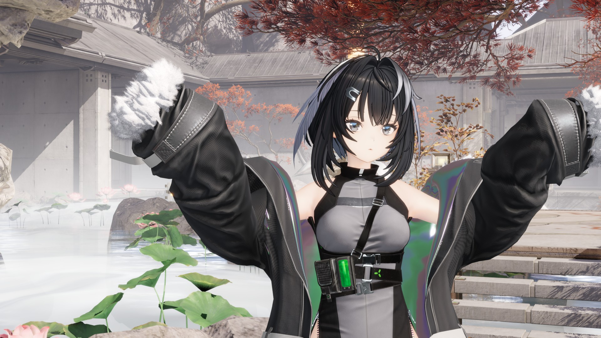

# RuriRipperImporter

**指着游戏安装目录,把里面的角色、场景、动作、表情和着色直接搬进 Blender 与 Substance Painter。**
不导 FBX,不转格式,不用先开 Unity。

```
游戏安装目录 ──▶ Ruri-RipperHook(读取器,C#)──▶ RuriRipperImporter(本仓,宿主插件)──▶ Blender / Substance Painter
```

基于 Blender **5.3+** 与 Substance Painter **12** 验证。

---

## 作品展示

### 【终末地/模型配布】羽毛笔 恋愛サーキュレーション



原创模型,整条链路在 Blender 里完成:插件指着终末地安装目录,直接导入游戏场景(祀的家)、表情库、生成的着色栈与后处理,建好的角色放进场景里用 EEVEE 渲染出片。

**成片与模型配布:** [bilibili · BV1L44t6kEXz](https://www.bilibili.com/video/BV1L44t6kEXz)

---

## 两个仓库,一条管线

| 仓库 | 角色 | 做什么 |
|---|---|---|
| [**Ruri-RipperHook**](https://github.com/FractalTools/Ruri.RipperHook) | 读取器 | AssetRipper / FModel 的 AOP 扩展层,认出游戏、读 CAB 依赖图、把网格骨架材质动画在内存里解成统一的数据集;插件下载的那份工具 DLL 就是它 |
| **RuriRipperImporter**(本仓) | 宿主插件 | Blender 与 Substance Painter 里的面板、导入、生成的着色栈、后处理、曝光渲染 |

游戏的差异全部在读取器那边解决,插件只认识读取器交出来的那一种形态:**支持一个新游戏是在 Ruri-RipperHook 加读取,不改本插件的加载代码**。

---

## 一个目录,两个宿主

Blender 从 `scripts/addons` 加载它,Substance Painter 从 `python/plugins` 加载**同一个目录**(做一个目录联接,见下)。面板一样、按钮一样、流程一样,区别只在最后落成什么:

| 按下 Import 之后 | 得到 |
|---|---|
| **Blender** | 骨架 + 蒙皮网格 + 材质 + 形态键 + 动画,一整套在场景里 |
| **Substance Painter** | 一个工程,模型已经在里面,**每个材质一个 Texture Set,并且接好了这个游戏的着色器** |

不用装两个插件、不用记两套操作,也不用先倒进 Blender 再手动搬去 Painter。

---

## 装它

### 两边都要的一步

读取器 DLL 不用手动下载:Blender 里启用插件后,**编辑 ▸ 偏好设置 ▸ 插件 ▸ RuriRipperImporter** 点 **Download / Update RipperHook**,它会下载最新构建并自动把 **Bin Dir** 指过去;默认还会在启动时和读取器启动失败时自动检查更新(更新后重启 Blender 生效)。Substance Painter 那边的 **Bin Dir** 填同一个文件夹即可。

更新插件代码后请完整退出并重开宿主,尤其是新增宿主能力或会话字段的版本;仅重载脚本或重新勾选插件会保留旧的桥接进程状态,不等同于完成升级。

### Blender

**编辑 ▸ 偏好设置 ▸ 插件 ▸ 安装…** → 选 `RuriRipperImporter` 文件夹或 zip → 勾选启用。

面板在 **3D 视图 ▸ 按 N ▸ 侧栏的 `RuriRipper` 页签**。

> **OneDrive 注意**:`%APPDATA%\Blender` 被 OneDrive 同步的话,Blender 的「从磁盘安装」可能静默解压失败。要么先暂停 OneDrive,要么设环境变量 `BLENDER_USER_SCRIPTS=D:\某个不同步的路径`,把文件夹丢进它的 `addons\` 里。

### Substance Painter

**不要复制一份**,做个目录联接指到 Blender 那份(管理员 CMD 里跑一次):

```bash
mklink /J "%USERPROFILE%\Documents\Adobe\Adobe Substance 3D Painter\python\plugins\RuriRipperImporter" "<你的 Blender addons 目录>\RuriRipperImporter"
```

然后开 Painter → 在 **Python 菜单里勾上 `RuriRipperImporter`** → 重启 Painter。面板在**右侧面板条**上,图标是 **R**(关掉了也用它开回来)。

---

## 用它

面板从上往下就是流程,两边一模一样:

1. **Assets 页签**里 **Add Install**,**Game Root** 指到游戏安装目录:读取器读安装自己发布的身份,自动挑好解码器。
2. **Load** 一次:没有 cabmap(这个安装的资源索引)就现建一个,有就直接读。
3. 上面一排页签变成**这个安装能给的东西**。
4. 列表里点一行 → 底下的导入选项 → **Import Selected**(或 **Import Everything Listed**)。

### 页签是算出来的,不是写死的

**有哪些页签 = 这个游戏公布了什么 × 这个软件做得了什么。** 没有哪一行代码写着「终末地有 Character 页签」:读取器公布了一份名册,名册这个页签就亮;它没公布表情库,表情页签就不在。所以每个游戏看到的页签不一样,同一个游戏在两个软件里看到的也不一样,而且**装一个新游戏不需要改插件**。

| 页签 | 是什么 | 按下去 |
|---|---|---|
| **Assets** | 整个安装的资源浏览器:搜名字、按类型过滤、进文件夹、多选 | Import Selected |
| **Character** | 这个游戏的名册 | Import Selected |
| **Scene** | 场景 / 地点 / 场景里的摆放 | Import Selected |
| **Catalog** | 角色是拼出来的那种游戏,这里是部件清单 | Import Selected |
| **Animations** | 这个安装的动作库 | Play On Rig(先选中一副骨架) |
| **Expressions** | 表情库 | Drive This Expression(先选中一个角色) |
| **Stage** | 剧情单元 / 过场 | **Build Stage**:布景、演员、镜头、台词一次摆好,按播放就演 |
| **Look** | 画面与着色旋钮 | 就地改 |
| **Diagnostics** | 这个安装关于自己的说明(不是内容) | 只看 |

选中的行**没有**「导入」这个动作时(比如一条表情、一段动作),那个按钮就不在:它有自己的动作,不会给你一个按下去什么都不发生的按钮。

### 有些东西 Painter 那边不出现,这是故意的

Painter 没有骨骼、没有时间轴、没有形态键:这不是没做,是**它的 API 里根本没有那个面**(Adobe 自己发布的 Python 模块里,`morph` / `blend shape` / `skeleton` / `bone` / `animation` / `timeline` 全部零命中)。规矩是:**能跨的全跨,跨不了的整格消失。** 一个需要骨架的页签在 Painter 上不是灰的,是不存在的。

---

## 它怎么工作

| 一步 | 在哪 | 做什么 |
|---|---|---|
| 种子 | 列表里的一行 | 一行能被导入,是因为它的 Payload 列就是种子;面板里组合出来的选择(卡片 × 套装 × 槽位、地图 × 矩形 × 场景状态)也由读取器拼成种子 |
| 陈述 | 读取器的 `StatementSources` | 每个游戏一个回调认领自己的种子,产出 `core.statement.*`:节点、网格、骨架、材质、贴图、形态键、动画 |
| 加载 | `Kernel/app/loading.py` | 唯一的两个入口:`load` 放置,`perform` 动画;浏览器、名册、场景窗口、剧情舞台都走它俩 |
| 落地 | `Host/<宿主>/` | 把陈述落成本宿主的数据(`materialise`、`play`),画出内核描述的面板,操作本宿主自己的设置 |
| 着色 | `Game/<作品>/shader/<宿主>/` | 生成器部署的着色栈与后处理:模板组和编好的材质随文件存盘,用户拧过的值留在节点上 |
| 导出 | `Kernel/usd` | 把陈述写成分层 USD:静态单元与角色各一层带自己的 textures,片段写成 SkelAnimation 层 |

层界:`Kernel/` 不认识任何宿主 API 与游戏名,`Host/<宿主>/` 不认识别的宿主与任何游戏,`Game/<作品>/` 只放面板与生成的着色栈。宿主差异是 `Kernel/host.py` 的协议类(SceneGraph、Compositor、Rig、Timeline、MorphTargets…),命令按协议声明需要什么,宿主答不出的那一格就不出现。

---

## 只有 FBX 二进制怎么办

模型在 Unity 工程里只有二进制 `.fbx` 时,附带的 **`RuriYamlDumper/RuriYamlDumper.cs`** 能在 Unity 里把它转成可读的 YAML:

1. 把 `RuriYamlDumper.cs` 丢进 Unity 工程任意 `Editor/` 文件夹。
2. **Project Settings ▸ Editor ▸ Asset Serialization** 设为 **Force Text**。
3. Project 窗口右键模型 → **Ruri ▸ Dump Model to YAML (for Blender)**。
4. 导入生成的 `<model>_yaml/<model>.prefab`。

它会实例化模型、**完全解包** prefab 连接,抽出并重指向每个 Mesh / 内嵌 Material / Avatar / AnimationClip,存成扁平 prefab。

---

## 已知边界

- **默认只要 LOD0**;要别的在导入选项里改 Detail Level,`-1` 是全都要。
- **`ShadowsOnly` 阴影代理网格**默认丢弃,同样有开关。
- **顶点法线**解不出可信结果时退回软件自算:宁可让它重算,也不会把垃圾法线塞给你。
- **切线**不随网格烘进来:着色栈按 UV 现算,改过拓扑的网格不会读到一份过期的切线。
- **humanoid 动画**完整还原(肌肉、重定向、根运动);前提是 Avatar 在作用域内,找不到时会明确警告,不会静默给你一副不动的骨架。
- **材质**按角色表接线(base / normal / emission / 打包 PBR 通道),**没有哪一条是靠猜属性名的**;认不出来的属性会在警告里列出来而不是乱接。要完整还原游戏画面靠的是生成的着色栈,不是拿 Principled 凑。
- **两个宿主是同一条规矩**:生成的着色栈认领它认得的材质(按材质指向的那个着色器),认不出来的按角色表接本软件自己的 PBR 着色器,所以**没有配方的作品照样导得进模型和材质**。报告里会写「N 个接到生成的着色器,M 个按角色」;配方一个作品一份,由生成器写到 `Game/<作品>/shader/<宿主>/`,补配方在生成器仓里做,不在本仓。
- **后处理**是每次开文件由插件现装的会话数据,存盘不带;没装插件的机器打开同一个文件没有这一级。
- **Stage** 里这个软件演不了的指令(音频、遮罩、口型)会在时间轴上留一个**标记**,标明它在第几帧发生,不会静默丢掉。

---

## 给要改代码的人

克隆时别忘了子模块:

```bash
git clone --recurse-submodules https://github.com/ShiyumeMeguri/RuriRipperImporter.git
```

```bash
git submodule update --init --recursive
```

层界与规矩见 [CLAUDE.md](CLAUDE.md);读取器那边的框架事实见 [Ruri-RipperHook](https://github.com/FractalTools/Ruri.RipperHook) 的 FRAMEWORK.md。
